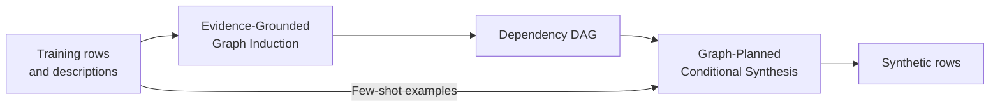

# StructSynth

**Dependency Graphs as Generation Plans for Low-Data Tabular Synthesis with Language Models**

Siyi Liu, Yujia Zheng, Haoyang Li, and Yongqi Zhang

StructSynth generates tabular data from scarce examples by treating a learned
dependency graph as a **generation plan for a black-box LLM**. The graph determines
the generation order, conditioning context, and scope of each prompt. Both graph
induction and data synthesis use inference-time prompting, without LLM fine-tuning.

[Method](#method) · [Paper results](#paper-results) · [Quick start](#quick-start) ·
[Run an experiment](#run-an-experiment) · [Development](#development)

## Method

The method has two stages, corresponding to Sections 3.1 and 3.2 of the paper:

1. **Evidence-Grounded Graph Induction.** An LLM selects source attributes and
   expands a directed graph through breadth-first search. Attribute semantics,
   few-shot examples, and statistical associations from the training data guide
   each proposed link. LLM-based cycle resolution produces a dependency DAG.
2. **Graph-Planned Conditional Synthesis.** The LLM generates attributes in
   topological layers, conditioned on **all previously generated values**. Each
   prompt includes the subgraph induced by the current layer and its parents to
   make the planned dependencies explicit. Attributes outside the graph are
   completed last, conditioned on the generated graph attributes.



The DAG specifies a generation plan; its edges do not establish ground-truth
causal relations. Association evidence uses bias-corrected Cramér's V for
categorical pairs, absolute Pearson correlation for numerical pairs, and the
correlation ratio for mixed pairs. See the implementation notes for
[graph induction](docs/decisions_graph.md) and [generation](docs/decisions_generation.md).

## Paper results

The main experiment uses **100 real training rows and 1,000 synthetic rows**,
with `gpt-4o-mini` at temperature `0.9`. XGBoost is trained on real training data
plus synthetic data and evaluated on a held-out real test set. Results are
reported over ten seeds, 42 through 51.

Table 1 of the paper reports the following downstream scores. Classification uses
AUC and regression uses R²; values are multiplied by 100 and reported as mean ±
standard deviation.

| Dataset | Task | Real training data only | Real + StructSynth |
|---|---|---:|---:|
| Adult | Binary classification | 82.51 ± 1.93 | **85.55 ± 1.08** |
| Anxiety | Three-class classification | 85.49 ± 1.60 | **86.45 ± 0.57** |
| Compas | Binary classification | 64.84 ± 2.51 | **69.40 ± 0.25** |
| Salary | Regression | 49.71 ± 7.02 | **55.98 ± 2.96** |
| Obesity | Regression | 59.83 ± 6.40 | **62.27 ± 5.40** |
| Churn | Binary classification | 86.86 ± 3.78 | **90.39 ± 1.96** |

Across the fourteen compared generators, StructSynth has the best mean utility
on all six datasets, with an average rank of **1.00**. Table 2 reports an average
privacy-risk rank of **1.50**, using distance from `0.5` as the ranking criterion,
and a statistical fidelity-error rank of **9.50**. The privacy metric measures
record proximity; StructSynth provides no formal privacy guarantee.

The paper also evaluates graph recovery on Asia, Child, and Insurance, sample
sizes from 20 to 200, and alternative LLM backbones and downstream evaluators.
These are paper-reported experiments. This repository provides the StructSynth
pipeline and an Adult example; the full baseline suite and six-dataset benchmark
are not bundled. Local offline tests check implementation behavior and do not
reproduce the paper's model-quality scores.

## Quick start

Use Python 3.9 or newer; Python 3.11 is the primary tested environment. Run these
commands from the project root:

```bash
python3.11 -m venv .venv
source .venv/bin/activate
python -m pip install --upgrade pip
python -m pip install -e '.[evaluation]'

structsynth demo --output-dir runs/demo --model xgboost --max-workers 2
structsynth demo --output-dir runs/demo --model xgboost --max-workers 2 --resume
```

The demo makes no network requests and requires no API key. It copies training
rows through a deterministic client to exercise graph induction, generation,
XGBoost evaluation, saved artifacts, and resumption. Its scores are software
checks, not measurements of LLM synthesis quality.

Installation options are defined in [`pyproject.toml`](pyproject.toml):

| Use | Command |
|---|---|
| Core package; offline demo with the default logistic evaluator | `python -m pip install -e .` |
| Experiments with XGBoost | `python -m pip install -e '.[evaluation]'` |
| Development, tests, and builds | `python -m pip install -e '.[dev,evaluation]'` |

Editable installation (`-e`) uses the working tree directly. Omit `-e` for a
regular installation.

## Run an experiment

[`configs/adult.yaml`](configs/adult.yaml) uses the included Adult CSV and metadata.
Paths inside a configuration resolve relative to **that configuration file**,
independent of the shell's working directory.

### Configuration and the paper's main setting

The example shares the paper's training size, LLM sampling parameters, and
downstream evaluation protocol. Its prompt-example count and prefix evaluation
are configurable:

| Setting | Included Adult example | Paper's main setting |
|---|---|---|
| Real training rows (`data.shots`) | `[100]` | 100 |
| Prompt examples (`data.example_rows`) | **20** | **All 100 training rows** |
| Synthetic rows (`generation.n_samples`) | `[100, 200, 500, 1000]`, evaluated as prefixes of one 1,000-row generation | 1,000 |
| Seeds (`data.seeds`) | 42–51 | 42–51 |
| LLM, for both stages | `gpt-4o-mini` | `gpt-4o-mini` |
| LLM sampling | `temperature: 0.9`, `top_p: 0.95`, `max_tokens: 8000` | Same values; Table 7 |
| Downstream evaluation | XGBoost on real train + synthetic, scored on real test | Same protocol |

For the paper's 100-shot prompt context, set `data.example_rows` to **100** in
the existing YAML file. Set `generation.n_samples` to **`[1000]`** to evaluate
only the main synthesis size. The included multi-size option evaluates paired
prefixes within each seed; it does not generate four independent datasets.
Each seed induces its own graph.

With the included configuration, the original table is first split 80:20, then
the requested training rows are sampled from the training pool. Unused training-pool
rows and test rows are excluded from LLM prompts. Classification splits preserve classes;
stratification, prompt balancing, privacy ties, and fidelity binning are documented
[implementation choices](docs/decisions_evaluation.md).

### Execute and resume

```bash
# Inspect output paths and request limits without contacting a model.
structsynth plan --config configs/adult.yaml --seeds 42

# Set credentials before live discovery or generation.
export OPENAI_API_KEY='your-key'
structsynth run --config configs/adult.yaml --seeds 42
structsynth run --config configs/adult.yaml --seeds 42 --resume
```

Omit `--seeds 42` to run all ten configured seeds. `--shots` and `--seeds` override
the configured training sizes and seeds for this invocation. A local real-only
baseline is evaluated and saved before the first model request.

The client sends JSON chat-completion requests to the configured `base_url`.
Each stage's `api_key_env` names the environment variable read at request time;
the default is `OPENAI_API_KEY`. Configure `base_url`, `model`, and `api_key_env`
in the YAML file for other endpoints. The endpoint must support the requested
model and parameters. `.env` files are not loaded automatically, and key values
are excluded from run identities and request logs.

To execute individual stages:

```bash
structsynth split --config configs/adult.yaml --seeds 42
structsynth discover --config configs/adult.yaml --seeds 42 --resume
structsynth generate --config configs/adult.yaml --seeds 42 --resume
structsynth evaluate --config configs/adult.yaml --seeds 42 --resume
```

The three entry scripts in [`scripts/`](scripts/README.md) provide the same
`split`, `discover`, and `generate` stages. Use `--resume` to continue an existing
experiment across stages. Generation and evaluation are separate commands.

### Use another dataset

Provide a CSV, a metadata JSON file, and a configuration. Specify the prediction
task explicitly as `classification` or `regression`. For example:

```json
{
  "name": "example",
  "target_column": "outcome",
  "task_type": "classification",
  "categorical_columns": ["group", "outcome"],
  "integer_columns": ["age"],
  "descriptions": {"age": "Age in years", "group": "Group", "outcome": "Label"},
  "task": "Describe the table's prediction task."
}
```

Metadata also accepts the `label_column` and `description` aliases. Optional
`categories` defines hard categorical domains; otherwise, ordinary categorical
features may contain values unseen in the small training set. Classification
targets use a train-derived closed label domain. `boolean_columns` and
`nullable_columns` make those types explicit. Privacy and fidelity evaluation
require finite numerical observations; disable evaluation for generation-only
tasks that permit missing numerical data.

Set `data.cleaning` explicitly when using the Adult or Anxiety transformations;
other datasets default to `none`. See [data and evaluation notes](docs/decisions_evaluation.md)
for preprocessing, metric definitions, and unsupported inputs.

## Outputs, recovery, and replay

Each experiment writes to:

```text
<output_dir>/<dataset>/<shot>_shot/seed_<seed>/<identity-prefix>/
  manifest.json                    identity, stage status, environment, artifact hashes
  split.json, schema.json           data provenance and train-derived metadata
  train.csv, test.csv, examples.csv
  real_baseline.json
  graph.json, discovery_events.json
  discovery_requests.jsonl          discovery requests, responses, and usage
  generation_requests.jsonl         generation requests, responses, and usage
  checkpoints/                     generation progress and attempt counts
  synthetic.csv, synthetic.json     complete generated table
  n1000/metrics.json, ...           results for each configured synthesis size
  metrics.json, usage.json
```

The included configuration sets `output_dir` to `runs/` in the project root.
`--resume` verifies configuration, inputs, source code, dependency versions, and
saved artifacts. Changes to data, method settings, code, or dependencies create
a new run directory. Generation resumes verified batches; interrupted discovery
restarts graph induction with its existing request budget. Request logs contain
prompt examples and responses, and must remain with the run for recovery or replay.

`request_limit` bounds attempted API calls, including transport retries. An
optional `token_limit` stops subsequent calls once reported usage reaches the
limit; an in-flight response can exceed it. Unknown usage remains unknown.

To replay a completed run without model requests, select one shot and seed and
provide its source journals:

```bash
structsynth run --config configs/adult.yaml --shots 100 --seeds 42 \
  --replay-dir 'runs/adult/100_shot/seed_42/<source-run-id>'
```

Replay requires matching inputs, configuration, and prompt protocol. It records
zero new API consumption and preserves original usage separately. Saved responses
support exact replay; a remote model's seed alone does not guarantee determinism.

Complete experiment runs write summaries beneath `<output_dir>/summaries/`.
To aggregate selected run directories independently:

```bash
structsynth report --run-dirs '<run-directory-1>' '<run-directory-2>' \
  --output-dir runs/review
```

Reports group compatible experiments and compute means and sample standard
deviations across seeds. Missing metrics and conflicting duplicate seeds are
reported explicitly. Offline, replay, and live results are kept in separate groups.
Metrics are stored in their original units. The Table 1 scores reproduced above
display AUC and R² multiplied by 100.

## Development

```bash
python -m pip install -e '.[dev,evaluation]'
python -m pytest -q
ruff check src tests scripts
python -m build
```

The tests use local responses and transports and do not call a model API.
CI also runs an offline XGBoost demo, checks resumption, and builds both release
formats. [`MANIFEST.in`](MANIFEST.in) includes scripts, configurations, method
notes, tests, and Adult inputs in the source distribution. The wheel contains the
package, its reading guide, and the `structsynth` command.

```text
configs/                  experiment configurations
data/adult/               example CSV and metadata
docs/                     method and implementation notes
scripts/                  entry scripts for individual stages
src/structsynth/
  data/                   loading, validation, metadata, and sampling
  structure/              association evidence, DAGs, induction, and prompts
  generation/             planning, prompts, validation, checkpoints, and synthesis
  llm/                    provider client, accounting, and replay
  evaluation/             utility, privacy, fidelity, and multi-seed reports
  pipeline/               experiment identity and stage orchestration
tests/                    offline regression tests
```

Shared contracts live in `schema.py`, `config.py`, and `artifacts.py`; commands
enter through `cli.py`. The [package guide](src/structsynth/README.md) explains
the reading order, dependency direction, and where to make each kind of change.
Generated runs, build output, caches, and local environments are excluded from Git
and release packages.

## Citation

If you use StructSynth, please cite the accompanying paper:

```bibtex
@misc{structsynth,
  title = {StructSynth: Dependency Graphs as Generation Plans for Low-Data Tabular Synthesis with Language Models},
  author = {Liu, Siyi and Zheng, Yujia and Li, Haoyang and Zhang, Yongqi},
  note = {Manuscript}
}
```
