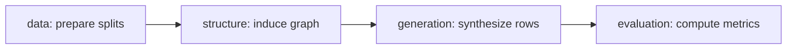

# StructSynth

**Dependency Graphs as Generation Plans for Low-Data Tabular Synthesis with Language Models**

StructSynth uses a learned dependency graph to guide tabular data generation with
a black-box LLM in low-data settings. It combines **Evidence-Grounded Graph
Induction** with **Graph-Planned Conditional Synthesis**, without LLM fine-tuning.
See the [paper on arXiv](https://arxiv.org/abs/2508.02601) for the method,
experiments, and evaluation details.

## Installation

Requires Python 3.9 or newer; Python 3.11 is recommended. From the project root:

```bash
python3.11 -m venv .venv
source .venv/bin/activate
python -m pip install --upgrade pip
python -m pip install -e '.[evaluation]'
```

Dependencies and optional extras are defined in [`pyproject.toml`](pyproject.toml).

## Quick start

### Offline demo

Run the complete pipeline without an API key:

```bash
structsynth demo --output-dir runs/demo --model xgboost
```

The demo uses a local client that copies training rows to check the software pipeline.

### Run the Adult example

The included data and experiment settings are configured in
[`configs/adult.yaml`](configs/adult.yaml). Set your API key, inspect the plan,
and start an experiment:

```bash
export OPENAI_API_KEY='your-key'
structsynth plan --config configs/adult.yaml --seeds 42
structsynth run --config configs/adult.yaml --seeds 42
```

Omit `--seeds 42` to run all configured seeds. To resume an existing run:

```bash
structsynth run --config configs/adult.yaml --seeds 42 --resume
```

Configure data paths, model endpoints, and generation settings in YAML. Paths
inside the file are relative to its location; default outputs are saved under
`runs/`. Use `structsynth --help` for available commands, or the
[stage scripts](scripts/README.md) to run splitting, graph induction, and generation
separately.

## Code organization

The package separates the experiment workflow from the implementation of each
stage:

```text
configs/              YAML experiment configurations
data/adult/           example dataset and metadata
docs/                 implementation notes
scripts/              entry scripts for individual stages
src/structsynth/
├── cli.py            command parsing and dispatch
├── config.py         configuration loading and validation
├── schema.py         shared dataset schema (DatasetSpec)
├── artifacts.py      file I/O, locking, and content hashes
├── data/             loading, cleaning, splitting, and example sampling
├── structure/        association evidence, graph induction, and DAG operations
├── generation/       generation planning, prompts, and row validation
├── llm/              model clients, response parsing, and request accounting
├── evaluation/       downstream utility, privacy, fidelity, and result summaries
└── pipeline/         stage orchestration and experiment outputs
tests/                offline tests
```

### Execution flow

`structsynth run` enters through [`cli.py`](src/structsynth/cli.py), loads the YAML
configuration, and calls `run_experiments()` in
[`pipeline/runner.py`](src/structsynth/pipeline/runner.py). The runner iterates over
the configured training sizes and seeds, calling `run_experiment()` for each:



The data stage produces training, test, and prompt-example sets. Graph induction
and synthesis use the training data and examples; the test split is reserved for
evaluation. `discover_structure()` builds a `DependencyGraph`, which
`GraphSynthesizer` uses to plan and execute generation in topological order.
Both stages access the model through the shared `llm/` interface.

The runner saves the splits, `graph.json`, and `synthetic.csv` in each run
directory. When evaluation is enabled, it also writes `metrics.json` and produces
summaries across seeds. The scripts in `scripts/` call the same CLI stages.

### Where to make changes

| Task | Start here |
|---|---|
| Add a dataset or adjust preprocessing | Copy [`configs/adult.yaml`](configs/adult.yaml); update [`data/loading.py`](src/structsynth/data/loading.py) for custom cleaning |
| Change graph induction | [`structure/associations.py`](src/structsynth/structure/associations.py) for statistical evidence; [`structure/discovery.py`](src/structsynth/structure/discovery.py) for the induction loop |
| Edit prompts | [`structure/prompts.py`](src/structsynth/structure/prompts.py) and [`generation/prompts.py`](src/structsynth/generation/prompts.py) |
| Change generation behavior | [`generation/planning.py`](src/structsynth/generation/planning.py) for stage ordering; [`generation/synthesizer.py`](src/structsynth/generation/synthesizer.py) for batching; [`generation/validation.py`](src/structsynth/generation/validation.py) for output checks |
| Configure or add a model client | Set `discovery_llm` and `generation_llm` in YAML; implement [`LLMClient`](src/structsynth/llm/contracts.py) for a custom backend and pass a `client_factory` to the runner |
| Extend evaluation | [`evaluation/`](src/structsynth/evaluation/) for metrics and summaries; [`pipeline/evaluation.py`](src/structsynth/pipeline/evaluation.py) for evaluation outputs |

For a first code read, start with `pipeline/runner.py`, then follow
`structure/discovery.py` and `generation/synthesizer.py`. The
[package guide](src/structsynth/README.md) provides the full module map and public
Python interfaces.

## Development

```bash
python -m pip install -e '.[dev,evaluation]'
python -m pytest -q
ruff check src tests scripts
python -m build
```

## Citation

If you use StructSynth, please cite the paper:

```bibtex
@misc{liu2026structsynthdependencygraphsgeneration,
  title={StructSynth: Dependency Graphs as Generation Plans for Low-Data Tabular Synthesis with Language Models},
  author={Siyi Liu and Yujia Zheng and Haoyang Li and Yongqi Zhang},
  year={2026},
  eprint={2508.02601},
  archivePrefix={arXiv},
  primaryClass={cs.LG},
  url={https://arxiv.org/abs/2508.02601},
}
```
