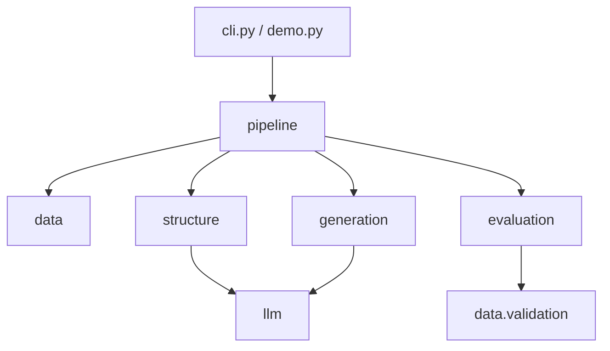

# StructSynth 代码导航

代码按六个业务职责组织：数据、结构诱导、生成、模型通信、评估、实验编排。
`config.py`、`schema.py` 和 `artifacts.py` 是各模块共享的配置、数据合同与文件操作。

## 建议阅读顺序

1. `schema.py`：理解 `DatasetSpec` 如何描述一张表。
2. `config.py`：理解一个实验包含哪些配置。
3. `pipeline/runner.py`：从 `run_experiment()` 看完整的阶段顺序。
4. `structure/discovery.py`：阅读论文第一阶段的图诱导流程。
5. `generation/synthesizer.py`：阅读论文第二阶段的逐层生成流程。
6. `evaluation/`：按需要查看下游效用、隐私和保真度指标。

调用命令从 `cli.py` 进入；完整的离线使用例子在 `demo.py`。

## 目录与责任

```text
structsynth/
├── cli.py                    命令解析与调用公共 API
├── demo.py                   离线运行示例
├── config.py                 配置对象和配置文件加载
├── schema.py                 DatasetSpec 共享合同
├── artifacts.py              原子文件、文件锁、JSON 和内容哈希
├── data/
│   ├── loading.py            CSV/元信息读取与显式清洗
│   ├── validation.py         表格与 DatasetSpec 一致性检查
│   ├── metadata.py           从训练集推断模式与统计描述
│   └── sampling.py           holdout、few-shot 与 prompt 示例抽样
├── structure/
│   ├── graph.py              DAG 合同、拓扑层与局部子图
│   ├── associations.py       关联证据计算
│   ├── prompts.py            source/successor/cycle 系统提示词
│   └── discovery.py          BFS 诱导、响应检查与环处理
├── generation/
│   ├── synthesizer.py        fit/generate 主控、批次调度与有限重试
│   ├── planning.py           从 DAG 构造生成阶段
│   ├── prompts.py            请求内容和响应 JSON schema
│   ├── validation.py         字段类型、类别和响应行校验
│   ├── checkpoints.py        生成检查点与恢复
│   ├── serialization.py      生成数据的严格 JSON 表示
│   └── errors.py             生成错误与检查点错误
├── llm/
│   ├── contracts.py          请求、响应、TokenUsage 与错误类型
│   ├── client.py             OpenAI-compatible HTTP 请求与传输重试
│   ├── ledger.py             请求预算、用量账本及中断恢复
│   ├── parsing.py            模型响应的 JSON 解析
│   └── replay.py             读取账本进行离线回放
├── evaluation/
│   ├── common.py             指标共用的数值/类别表示
│   ├── preprocessing.py      只在训练数据上拟合的编码器
│   ├── downstream.py         预测模型与 AUC/R² 等效用指标
│   ├── privacy.py            混合距离和最近邻隐私指标
│   ├── fidelity.py           各类属性对的保真度
│   └── reporting.py          多 seed 结果汇总与 JSON/CSV 报告
└── pipeline/
    ├── identity.py           实验身份、源码指纹与输出目录
    ├── evaluation.py         基线预检和各生成规模的评价产物
    └── runner.py             阶段执行、产物验证、恢复和实验网格
```

每个子包的 `__init__.py` 只列出公共导出。顶层 `associations.py`、`graph.py`、
`discovery.py`、`reporting.py` 是旧导入路径的薄兼容入口，实际实现分别在
`structure/` 和 `evaluation/reporting.py`；维护时修改实现文件。

## 依赖方向



配置、模式与存储工具是共享基础层，不反向导入业务流程。
`pipeline` 管理执行顺序和文件生命周期，指标算法留在 `evaluation`。
`structure` 和 `generation` 通过同一 LLM 合同通信，不直接发 HTTP 请求。
提供方的传输重试属于 `llm/client.py`；无效生成行的有限重试属于生成主控。

## 修改需求对应的位置

| 想修改什么 | 主要位置 |
|---|---|
| 新增数据集读取或清洗方式 | `data/loading.py` 与 `config.py` |
| 调整抽样和 prompt 示例选择 | `data/sampling.py` |
| 修改图诱导证据或边选择 | `structure/associations.py`、`structure/discovery.py` |
| 修改提示词 | `structure/prompts.py`、`generation/prompts.py` |
| 修改字段约束或生成响应校验 | `generation/validation.py` |
| 修改生成恢复行为 | `generation/checkpoints.py`，并检查主控调用 |
| 接入新的模型客户端 | 实现 `llm/contracts.py` 的 `LLMClient` 合同 |
| 修改计费/请求预算与回放 | `llm/ledger.py`、`llm/replay.py` |
| 新增预测模型或评价指标 | `evaluation/` 对应模块及配置枚举 |
| 调整多 seed 汇总 | `evaluation/reporting.py` |
| 调整实验输出位置或身份 | `pipeline/identity.py` |
| 调整阶段执行与恢复 | `pipeline/runner.py` |

## 公共接口与复现实验

原有公共导入继续可用，例如：

```python
from structsynth.data import load_dataset, split_dataset
from structsynth.generation import GraphSynthesizer
from structsynth.llm import OpenAICompatibleClient, UsageLedger
from structsynth.pipeline import run_experiment
from structsynth.structure import DependencyGraph, discover_structure
```

业务模块通过显式参数传递数据，不依赖全局实验状态。内部辅助函数不作为稳定 API。
本轮保留方法、默认参数、提示词、请求 key 和检查点协议；拆分后的源码位置变化会产生新的
实验身份。源码指纹递归覆盖子包，并使用相对路径区分同名文件，安装位置不参与指纹。
